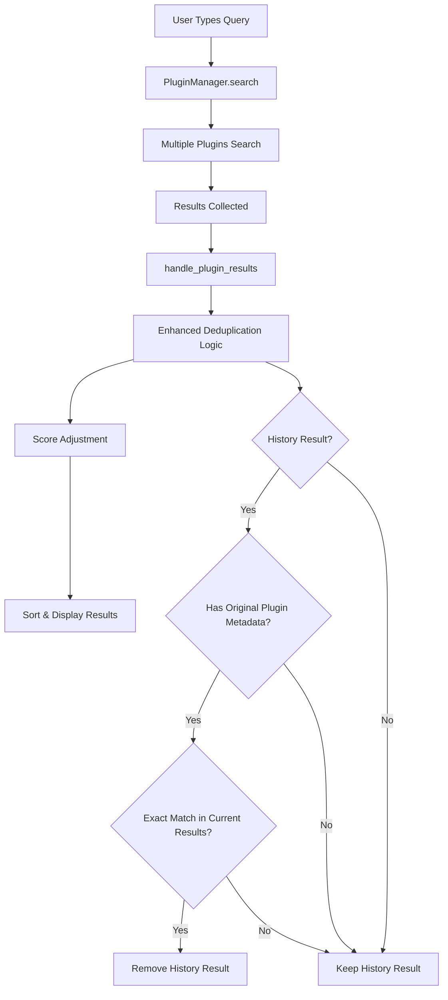
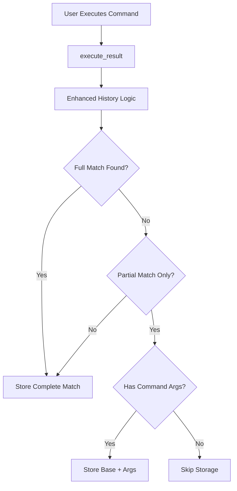

# Design Document

## Overview

The launcher deduplication feature enhances the existing search functionality by implementing intelligent result filtering and improved history management. The system will eliminate duplicate search results while preserving valuable historical data and implementing smarter history storage policies.

The design builds upon the existing plugin architecture, extending the current deduplication logic in `LauncherWindow._deduplicate_results()` and enhancing the history storage mechanism in `HistoryManager.add_user_input_history()`.

## Architecture

### Current System Analysis

The launcher uses a plugin-based architecture where:
- `PluginManager` coordinates search across multiple plugins
- Each plugin returns `SearchResult` objects with metadata
- `LauncherWindow.handle_plugin_results()` processes and deduplicates results
- `HistoryManager` stores execution history and provides usage statistics
- History plugin searches through stored history entries

### Deduplication Flow



### History Storage Flow



## Components and Interfaces

### 1. Enhanced Deduplication Engine

**Location**: `launcher/ui/launcher_window.py`

**Current Method**: `_deduplicate_results()`

**Enhancements**:
- Improved metadata validation
- Debug logging for transparency
- Graceful error handling
- Performance optimization for large result sets

**Interface**:
```python
def _deduplicate_results(self) -> None:
    """
    Remove history results if exact matches exist from other plugins.
    Enhanced with better error handling and logging.
    """
```

### 2. Smart History Storage Manager

**Location**: `launcher/core/history_manager.py`

**New Method**: `should_store_in_history()`

**Purpose**: Determine whether a search result should be stored based on match quality and context

**Interface**:
```python
def should_store_in_history(
    self,
    user_input: str,
    search_results: List[SearchResult],
    executed_result: SearchResult
) -> bool:
    """
    Determine if execution should be stored in history based on match quality.

    Args:
        user_input: Original user query
        search_results: All search results that were available
        executed_result: The result that was actually executed

    Returns:
        True if should store, False otherwise
    """
```

**New Method**: `increment_usage_count()`

**Purpose**: Increment usage count for existing entries without creating duplicates

**Interface**:
```python
def increment_usage_count(
    self,
    plugin_id: str,
    item_id: str,
    user_input: str = None
) -> bool:
    """
    Increment usage count for an existing history entry.

    Args:
        plugin_id: Plugin ID of the executed item
        item_id: Item ID of the executed item
        user_input: Optional user input to find specific entry

    Returns:
        True if count was incremented, False if entry not found
    """
```

### 3. Result Analysis Utilities

**Location**: `launcher/utils/result_analyzer.py` (new file)

**Purpose**: Analyze search results to determine match quality and relationships

**Interface**:
```python
class ResultAnalyzer:
    @staticmethod
    def is_exact_match(query: str, result: SearchResult) -> bool:
        """Check if result is an exact match for the query"""

    @staticmethod
    def is_partial_match(query: str, result: SearchResult) -> bool:
        """Check if result is only a partial match"""

    @staticmethod
    def has_command_arguments(query: str, result: SearchResult) -> bool:
        """Check if query contains command line arguments"""
```

### 4. Enhanced History Plugin Integration

**Location**: `launcher/plugins/history/plugin.py`

**Enhancement**: Improved metadata handling for deduplication

**Changes**:
- Ensure all history results include proper `original_plugin_id` and `original_item_id`
- Enhanced error handling when original plugin metadata is missing
- Better icon fallback logic

## Data Models

### SearchResult Metadata Extensions

The existing `SearchResult.metadata` dictionary will be enhanced to ensure consistent deduplication data:

```python
# Enhanced metadata for history results
metadata = {
    "original_plugin_id": str,      # Required for deduplication
    "original_item_id": str,        # Required for deduplication
    "history_entry": dict,          # Complete history entry data
    "usage_count": int,             # For display purposes
    "track_history": bool,          # Whether to track this execution
    "match_quality": str,           # "exact", "partial", "fuzzy"
}
```

### History Entry Structure

The existing history entry structure remains unchanged but will be populated more intelligently:

```python
history_entry = {
    "user_input": str,              # What user typed
    "executed_command": str,        # What was actually executed
    "description": str,             # Item description
    "plugin_id": str,               # Original plugin ID
    "item_id": str,                 # Original item ID
    "timestamp": float,             # When executed
    "usage_count": int,             # How many times used
    "icon_data": str,               # Base64 encoded icon (optional)
}
```

## Error Handling

### Deduplication Error Handling

1. **Missing Metadata**: If history results lack original plugin metadata, preserve them to avoid data loss
2. **Plugin Not Found**: If original plugin is no longer available, keep history result
3. **Search Failures**: Continue with available results if individual plugin searches fail
4. **Performance Issues**: Implement timeout and result limits to prevent UI blocking

### History Storage Error Handling

1. **Analysis Failures**: Default to storing execution if analysis fails
2. **File I/O Errors**: Log errors but don't block execution
3. **Invalid Data**: Sanitize and validate data before storage

## Testing Strategy

### Unit Tests

**File**: `tests/test_deduplication.py`

Test cases:
- History result with exact match in current results → removed
- History result with no current match → preserved
- History result with missing metadata → preserved
- Multiple history results with mixed scenarios
- Performance with large result sets

**File**: `tests/test_history_storage.py`

Test cases:
- Exact match execution → stored
- Partial match only → not stored
- Command with arguments → stored with base + args
- Edge cases and error conditions

### Integration Tests

**File**: `tests/test_search_integration.py`

Test scenarios:
- End-to-end search with deduplication
- History plugin interaction with other plugins
- UI responsiveness during deduplication
- Search result ordering after deduplication

### Performance Tests

- Deduplication with 100+ results
- History search with large history files
- Memory usage during intensive searches
- UI responsiveness benchmarks

## Implementation Phases

### Phase 1: Enhanced Deduplication Logic
- Improve existing `_deduplicate_results()` method
- Add comprehensive logging and error handling
- Ensure metadata validation

### Phase 2: Smart History Storage
- Implement `should_store_in_history()` logic
- Create `ResultAnalyzer` utility class
- Integrate with existing execution flow

### Phase 3: UI and Visual Improvements
- Ensure proper styling for history results (bold text)
- Maintain score-based ordering
- Preserve result metadata and display properties

### Phase 4: Testing and Optimization
- Comprehensive test suite
- Performance optimization
- Documentation updates

## Security Considerations

- Input sanitization for search queries
- Safe handling of stored icon data
- File system permissions for history storage
- Prevention of history file corruption

## Performance Considerations

- Efficient deduplication algorithms (O(n) complexity)
- Lazy loading of history data
- Result caching where appropriate
- Memory management for large result sets
- Debounced search to prevent excessive processing

## Backward Compatibility

- Existing history files remain compatible
- No breaking changes to plugin interfaces
- Graceful handling of legacy metadata formats
- Smooth migration path for existing users